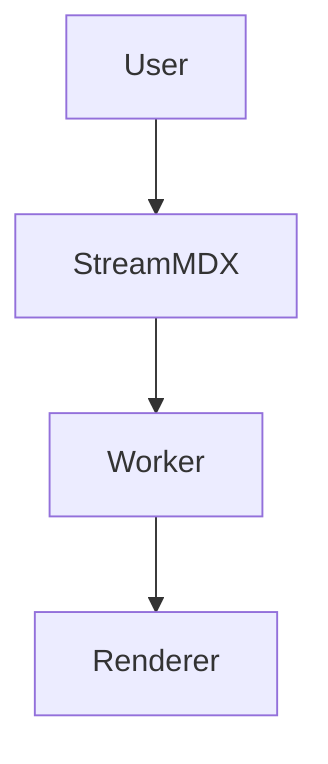

# Mermaid Diagrams

Mermaid is an optional addon. Register its engine only in apps that need diagram fences.

## Install

```bash
npm install @stream-mdx/mermaid
```

## Register the engine

`createMermaidEngine()` routes `mermaid` fences through the native code owner. It does not require a code wrapper or a read of the full `Block`.

```tsx
import { createMermaidEngine } from "@stream-mdx/mermaid";
import { StreamingMarkdown } from "stream-mdx";

const mermaidEngine = createMermaidEngine();

export function Article({ content }: { content: string }) {
  return (
    <StreamingMarkdown
      text={content}
      worker="/workers/markdown-worker.js"
      engines={{ mermaid: mermaidEngine }}
    />
  );
}
```

## Authoring example

````md

````

## Rendered example


## Default view and configuration

The engine includes a code/diagram toggle. Choose its initial view and Mermaid configuration when creating the engine:

```tsx
import { createMermaidEngine } from "@stream-mdx/mermaid";

const mermaidEngine = createMermaidEngine({
  config: { theme: "neutral" },
  defaultView: "diagram",
  debounceMs: 150,
  mermaid: () => import("mermaid"),
  errorComponent: ({ error, retry }) => (
    <div role="alert">
      <p>Diagram rendering failed: {error}</p>
      <button type="button" onClick={retry}>Retry diagram</button>
    </div>
  ),
});
```

The factory also accepts a pinned Mermaid module or async loader. Failed or incomplete diagrams report an error inside their own block; valid later source replaces that error. `deferHeavyBlocks` on `StreamingMarkdown` can opt Mermaid rendering into viewport deferral.

## Performance and safety notes

- Keep Mermaid rendering opt-in and behind a feature toggle in user-facing apps.
- Keep sanitization enabled for surrounding HTML content.
- Include a regression snapshot for a representative Mermaid page.

## Troubleshooting

- **No diagram appears**: verify `@stream-mdx/mermaid` is installed and `engines.mermaid` receives `createMermaidEngine()`.
- **Hydration mismatch**: keep server-rendered surrounding components deterministic.
- **Layout overflow**: add responsive container styles around the diagram.

## Next steps

- [MDX and HTML in StreamMDX](/docs/guides/mdx-and-html)
- [Testing and baselines](/docs/guides/testing-and-baselines)
- [Performance and backpressure](/docs/guides/performance-and-backpressure)
