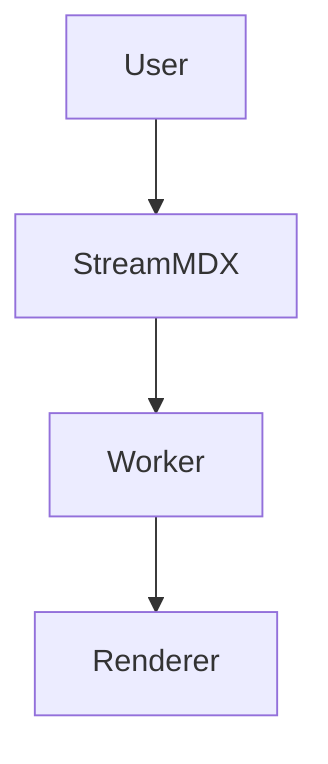

# Mermaid Diagrams

Mermaid is available as an optional addon so teams can opt in only when diagram rendering is needed.

## Why Mermaid is optional

- Keeps default bundle size lower.
- Avoids extra parsing/rendering cost in apps that do not use diagrams.
- Lets teams feature-flag diagram support by route or audience.

## Install

```bash
npm install @stream-mdx/mermaid
```

## Register the component

Mermaid rendering is an opt-in `components.code.wrapper` presentation. It inspects `metadata.language` and returns the prepared native code children for other languages:

```tsx
import { StreamingMarkdown, type NodeViewProps } from "stream-mdx";
import { MermaidBlock } from "@stream-mdx/mermaid";

function MermaidPresentation({ block, children, metadata, actions }: NodeViewProps) {
  if (metadata.language?.toLowerCase() !== "mermaid") return children;
  const code = block?.payload.meta?.code;
  return (
    <MermaidBlock
      code={typeof code === "string" ? code : ""}
      renderCode={children}
      language={metadata.language ?? "mermaid"}
      blockId={metadata.id}
      controls={{ copy: true }}
      copy={actions.copy}
    />
  );
}

<StreamingMarkdown text={content} worker="/workers/markdown-worker.js" components={{ code: { wrapper: MermaidPresentation } }} />;
```

## Authoring example

````md

````

## Rendered example


## UX details

The Mermaid block renderer includes a code/diagram toggle by default.

Use `defaultView` to control first render mode:

```tsx
function DiagramPresentation({ block, children, metadata, actions }: NodeViewProps) {
  if (metadata.language?.toLowerCase() !== "mermaid") return children;
  const code = block?.payload.meta?.code;
  return (
    <MermaidBlock
      code={typeof code === "string" ? code : ""}
      renderCode={children}
      language={metadata.language ?? "mermaid"}
      blockId={metadata.id}
      controls={{ copy: true }}
      copy={actions.copy}
      defaultView="diagram"
    />
  );
}

<StreamingMarkdown text={content} components={{ code: { wrapper: DiagramPresentation } }} />;
```

### Custom configuration and error handling

Use `createMermaidBlock` to configure global Mermaid options, default views, debounce intervals, a custom/pinned Mermaid module or async loader, or a custom error component with retry capability:

```tsx
import { createMermaidBlock } from "@stream-mdx/mermaid";
import { StreamingMarkdown, type NodeViewProps } from "stream-mdx";

const CustomMermaidBlock = createMermaidBlock({
  config: { theme: "neutral" },
  defaultView: "diagram",
  debounceMs: 150,
  mermaid: () => import("mermaid"),
  errorComponent: ({ error, retry }) => (
    <div className="rounded-lg border border-red-500/30 bg-red-500/10 p-3 text-sm">
      <p className="font-medium text-red-700 dark:text-red-300">Diagram rendering failed: {error}</p>
      <button type="button" onClick={retry} className="mt-2 text-xs underline">Retry diagram</button>
    </div>
  ),
});

function CustomMermaidPresentation({ block, children, metadata, actions }: NodeViewProps) {
  if (metadata.language?.toLowerCase() !== "mermaid") return children;
  const code = block?.payload.meta?.code;
  return (
    <CustomMermaidBlock
      code={typeof code === "string" ? code : ""}
      renderCode={children}
      language={metadata.language ?? "mermaid"}
      blockId={metadata.id}
      controls={{ copy: true }}
      copy={actions.copy}
    />
  );
}

<StreamingMarkdown text={content} components={{ code: { wrapper: CustomMermaidPresentation } }} />;
```

Recommendations:

- Keep source code view available for debugging and copy/paste.
- Use overflow-safe wrappers on narrow screens.
- Prefer diagram view only for docs pages where the diagram is primary content.

## Performance and safety notes

- Mermaid rendering should remain opt-in and behind a feature toggle in user-facing apps.
- Keep sanitization enabled for surrounding HTML content.
- Include one regression snapshot for a representative Mermaid page.

## Troubleshooting

- **No diagram appears**: verify `@stream-mdx/mermaid` is installed and `components.code.wrapper` routes `metadata.language === "mermaid"` to `MermaidBlock`.
- **Hydration mismatch**: ensure wrappers/components around Mermaid are deterministic.
- **Layout overflow**: add responsive container styles around the diagram block.

## Next steps

- [MDX and HTML in StreamMDX](/docs/guides/mdx-and-html)
- [Testing and baselines](/docs/guides/testing-and-baselines)
- [Performance and backpressure](/docs/guides/performance-and-backpressure)
