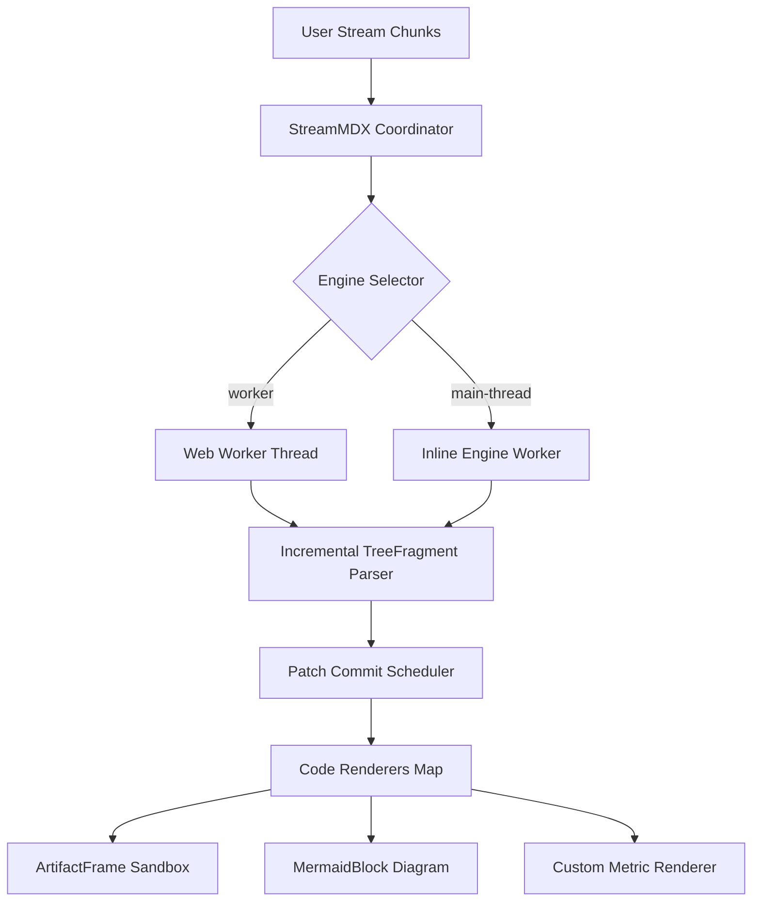

# Architectural Analysis & Performance Report

StreamMDX engine-v2 provides zero-lag streaming markdown parsing with dual engine execution modes: dedicated Web Worker threads and inline main-thread execution.

### Theoretical Convergence Model

Under incremental streaming, patch-to-DOM commit latency $T_{\text{commit}}$ is bounded by the available frame budget $B_{\text{frame}}$:

$$T_{\text{commit}} \le B_{\text{frame}} \implies \Delta_{\text{latency}} = \mathcal{O}(1)$$

The sustained token processing throughput $\mathcal{T}_{\text{throughput}}$ maintains linear scaling across batch flushes:

$$\mathcal{T}_{\text{throughput}} = \lim_{\Delta t \to 0} \frac{N_{\text{tokens}}(\Delta t)}{\Delta t} \cdot \left(1 - \frac{T_{\text{reparse}}}{T_{\text{frame}}}\right)$$

### Engine Execution Pipeline

The flow below illustrates how incoming prompt tokens are scheduled across the dual engine boundary into safe UI renderers:



### Verified Runtime Metrics

The following metrics are parsed through a custom code fence renderer (`metric`):

```metric
{
  "p95Latency": "3.8ms",
  "tokenVelocity": "1280 t/s",
  "memoryFootprint": "4.2MB",
  "cacheHitRate": "99.4%"
}
```

### Sandboxed Visualization Artifact

Below is an interactive system telemetry visualization sandboxed via `ArtifactFrame`. It runs in an isolated iframe with `sandbox="allow-scripts"` and a strict Content Security Policy (`connect-src 'none'`), preventing external data exfiltration while rendering self-contained SVG graphics:

```html-artifact
<!DOCTYPE html>
<html>
<head>
  <meta charset="utf-8">
  <style>
    body {
      font-family: -apple-system, BlinkMacSystemFont, "Segoe UI", Roboto, sans-serif;
      margin: 0;
      padding: 14px;
      background: #0f172a;
      color: #f8fafc;
    }
    .card {
      border: 1px solid #334155;
      border-radius: 8px;
      padding: 14px;
      background: #1e293b;
    }
    .title {
      font-size: 13px;
      font-weight: 600;
      color: #38bdf8;
      margin-bottom: 8px;
    }
    .stat-grid {
      display: grid;
      grid-template-columns: repeat(3, 1fr);
      gap: 8px;
      margin-bottom: 12px;
    }
    .stat-box {
      background: #0f172a;
      border: 1px solid #334155;
      border-radius: 6px;
      padding: 8px;
    }
    .stat-label {
      font-size: 10px;
      color: #94a3b8;
      text-transform: uppercase;
    }
    .stat-value {
      font-size: 14px;
      font-weight: 700;
      color: #f1f5f9;
      margin-top: 2px;
    }
    .chart-container {
      background: #0f172a;
      border: 1px solid #334155;
      border-radius: 6px;
      padding: 8px;
    }
    .link-row {
      margin-top: 10px;
      font-size: 11px;
      color: #94a3b8;
      display: flex;
      justify-content: space-between;
      align-items: center;
    }
    .link-row a {
      color: #38bdf8;
      text-decoration: underline;
    }
  </style>
</head>
<body>
  <div class="card">
    <div class="title">Sandboxed Execution Metrics & Canvas Trace</div>
    <div class="stat-grid">
      <div class="stat-box">
        <div class="stat-label">Frame Budget</div>
        <div class="stat-value">16.6 ms</div>
      </div>
      <div class="stat-box">
        <div class="stat-label">DOM Commit</div>
        <div class="stat-value">1.8 ms</div>
      </div>
      <div class="stat-box">
        <div class="stat-label">CSP Status</div>
        <div class="stat-value">connect: none</div>
      </div>
    </div>
    <div class="chart-container">
      <svg width="100%" height="90" viewBox="0 0 380 90" preserveAspectRatio="none">
        <rect x="0" y="0" width="380" height="90" fill="#0f172a" />
        <line x1="20" y1="75" x2="360" y2="75" stroke="#334155" stroke-width="1" />
        <line x1="20" y1="45" x2="360" y2="45" stroke="#334155" stroke-dasharray="2,2" stroke-width="1" />
        <line x1="20" y1="15" x2="360" y2="15" stroke="#334155" stroke-dasharray="2,2" stroke-width="1" />
        <polyline fill="none" stroke="#38bdf8" stroke-width="2" points="20,70 60,65 110,40 160,48 210,25 260,32 310,18 360,20" />
        <circle cx="20" cy="70" r="3" fill="#38bdf8" />
        <circle cx="60" cy="65" r="3" fill="#38bdf8" />
        <circle cx="110" cy="40" r="3" fill="#38bdf8" />
        <circle cx="160" cy="48" r="3" fill="#38bdf8" />
        <circle cx="210" cy="25" r="3" fill="#38bdf8" />
        <circle cx="260" cy="32" r="3" fill="#38bdf8" />
        <circle cx="310" cy="18" r="3" fill="#38bdf8" />
        <circle cx="360" cy="20" r="3" fill="#38bdf8" />
        <text x="20" y="86" font-size="8" fill="#64748b" font-family="system-ui">0ms</text>
        <text x="180" y="86" font-size="8" fill="#64748b" font-family="system-ui">Target</text>
        <text x="340" y="86" font-size="8" fill="#64748b" font-family="system-ui">30ms</text>
      </svg>
    </div>
    <div class="link-row">
      <span>Isolated iframe (no allow-same-origin)</span>
      <a href="https://github.com/kmccleary3301/stream-mdx" target="_blank">Safe Link Test</a>
    </div>
  </div>
</body>
</html>
```

### Security & Outbound Link Safety

All hyperlinks in generated agent markdown and enclosed artifacts are subject to safe defaults (`features.mdx: false`). Outbound navigation is intercepted by `linkSafety`:

- Test external link interception: [StreamMDX GitHub Repository](https://github.com/kmccleary3301/stream-mdx)
- Security documentation: [Deployment and Security Guide](/docs/guides/deployment-and-security)
