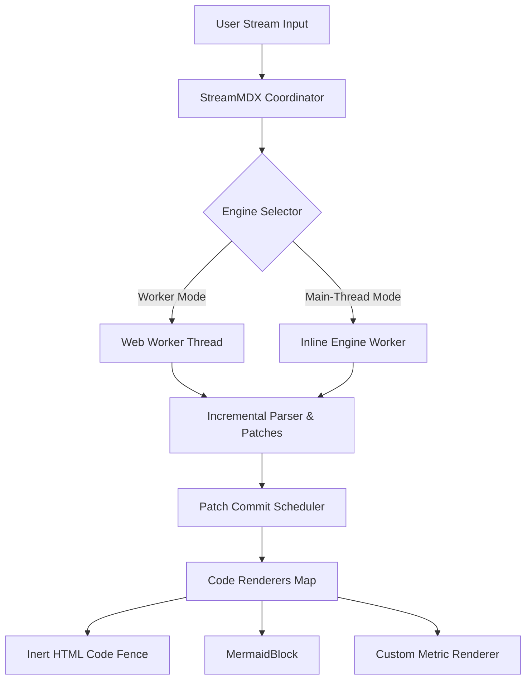

# Architecture walkthrough and inert code fences

StreamMDX engine-v2 supports dual engine execution modes: a dedicated Web Worker thread (offloading parser work from the main thread) and an inline main-thread engine (for environments without Web Worker support).

### Mathematical Formulation: Bayes' Theorem

In statistical inference and streaming token classification, posterior probabilities $P(A \mid B)$ are computed via Bayes' Theorem:

$$P(A \mid B) = \frac{P(B \mid A) \cdot P(A)}{P(B)}$$

Where $P(A)$ represents the prior probability, $P(B \mid A)$ is the likelihood under condition $A$, and the marginal normalization constant $P(B)$ expands over mutually exclusive partitions:

$$P(B) = \sum_{k=1}^{n} P(B \mid A_k) \cdot P(A_k)$$

For binary hypothesis testing with prior odds $\mathcal{O}(A) = \frac{P(A)}{1 - P(A)}$:

$$\log \mathcal{O}(A \mid B) = \log \mathcal{O}(A) + \log \left( \frac{P(B \mid A)}{P(B \mid \neg A)} \right)$$

### Engine Pipeline

The diagram below shows how prompt chunks flow through the engine selector into incremental parsers, the patch commit scheduler, and specialized code renderers:



### Custom Code Fence Renderer (Synthetic Sample)

The block below demonstrates a custom code fence renderer for the `metric` language. Note: **Example data, not a benchmark**.

```metric
{
  "sampleSet": "Synthetic-Distribution-42",
  "partitionCount": 4,
  "confidenceScore": "0.942",
  "sampleStatus": "Example data, not a benchmark"
}
```

### Fenced HTML sample (inert)

The sample below is shown as code only. `artifact` and `html-artifact` fences do not execute or mount a preview.

```html-artifact
<!DOCTYPE html>
<html>
<head>
  <meta charset="utf-8">
  <style>
    body {
      font-family: -apple-system, BlinkMacSystemFont, "Segoe UI", Roboto, sans-serif;
      margin: 0;
      padding: 14px;
      background: #0f172a;
      color: #f8fafc;
    }
    .card {
      border: 1px solid #334155;
      border-radius: 8px;
      padding: 14px;
      background: #1e293b;
    }
    .header {
      display: flex;
      justify-content: space-between;
      align-items: center;
      margin-bottom: 10px;
    }
    .title {
      font-size: 13px;
      font-weight: 600;
      color: #38bdf8;
    }
    .disclaimer {
      font-size: 10px;
      color: #94a3b8;
      font-style: italic;
    }
    .btn {
      background: #334155;
      color: #f8fafc;
      border: 1px solid #475569;
      border-radius: 4px;
      padding: 5px 10px;
      font-size: 11px;
      cursor: pointer;
    }
    .btn:hover {
      background: #475569;
    }
    .stat-grid {
      display: grid;
      grid-template-columns: repeat(3, 1fr);
      gap: 8px;
      margin: 10px 0;
    }
    .stat-box {
      background: #0f172a;
      border: 1px solid #334155;
      border-radius: 6px;
      padding: 8px;
    }
    .stat-label {
      font-size: 10px;
      color: #94a3b8;
      text-transform: uppercase;
    }
    .stat-value {
      font-size: 13px;
      font-weight: 700;
      color: #f1f5f9;
      margin-top: 2px;
    }
    .chart-box {
      background: #0f172a;
      border: 1px solid #334155;
      border-radius: 6px;
      padding: 8px;
    }
    .footer {
      margin-top: 10px;
      font-size: 11px;
      color: #94a3b8;
      display: flex;
      justify-content: space-between;
      align-items: center;
    }
    .footer a {
      color: #38bdf8;
      text-decoration: underline;
    }
  </style>
</head>
<body>
  <div class="card">
    <div class="header">
      <span class="title">Interactive Sample Distribution</span>
      <button id="toggle-btn" class="btn" type="button">Switch Sample Dataset</button>
    </div>
    <div class="disclaimer">Example data, not a benchmark</div>
    <div class="stat-grid">
      <div class="stat-box">
        <div class="stat-label">Dataset</div>
        <div id="stat-set" class="stat-value">Sample Set Alpha</div>
      </div>
      <div class="stat-box">
        <div class="stat-label">Observation Mean</div>
        <div id="stat-mean" class="stat-value">42.8</div>
      </div>
      <div class="stat-box">
        <div class="stat-label">Variance</div>
        <div id="stat-var" class="stat-value">6.14</div>
      </div>
    </div>
    <div class="chart-box">
      <svg width="100%" height="90" viewBox="0 0 380 90" preserveAspectRatio="none">
        <rect x="0" y="0" width="380" height="90" fill="#0f172a" />
        <line x1="20" y1="75" x2="360" y2="75" stroke="#334155" stroke-width="1" />
        <line x1="20" y1="45" x2="360" y2="45" stroke="#334155" stroke-dasharray="2,2" stroke-width="1" />
        <line x1="20" y1="15" x2="360" y2="15" stroke="#334155" stroke-dasharray="2,2" stroke-width="1" />
        <polyline id="chart-line" fill="none" stroke="#38bdf8" stroke-width="2" points="20,70 60,65 110,40 160,48 210,25 260,32 310,18 360,20" />
        <text x="20" y="86" font-size="8" fill="#64748b" font-family="system-ui">0</text>
        <text x="180" y="86" font-size="8" fill="#64748b" font-family="system-ui">50</text>
        <text x="340" y="86" font-size="8" fill="#64748b" font-family="system-ui">100</text>
      </svg>
    </div>
    <div class="footer">
      <span>Self-contained HTML sample; not executed</span>
      <a href="https://github.com/kmccleary3301/stream-mdx" target="_blank">Link Safety Check</a>
    </div>
  </div>
  <script>
    var currentDataset = 'Alpha';
    var toggleBtn = document.getElementById('toggle-btn');
    var chartLine = document.getElementById('chart-line');
    var statSet = document.getElementById('stat-set');
    var statMean = document.getElementById('stat-mean');
    var statVar = document.getElementById('stat-var');

    toggleBtn.addEventListener('click', function() {
      if (currentDataset === 'Alpha') {
        currentDataset = 'Beta';
        chartLine.setAttribute('points', '20,30 60,45 110,68 160,35 210,55 260,20 310,48 360,35');
        statSet.textContent = 'Sample Set Beta';
        statMean.textContent = '68.4';
        statVar.textContent = '12.08';
      } else {
        currentDataset = 'Alpha';
        chartLine.setAttribute('points', '20,70 60,65 110,40 160,48 210,25 260,32 310,18 360,20');
        statSet.textContent = 'Sample Set Alpha';
        statMean.textContent = '42.8';
        statVar.textContent = '6.14';
      }
    });
  </script>
</body>
</html>
```

### Outbound link handling

`linkSafety` applies to links rendered by StreamMDX's Markdown link renderer. It does not secure custom renderer output. The HTML example above is an inert code fence; its script does not run.

- Test external link interception: [StreamMDX GitHub Repository](https://github.com/kmccleary3301/stream-mdx)
- Security documentation: [Deployment and Security Guide](/docs/guides/deployment-and-security)
