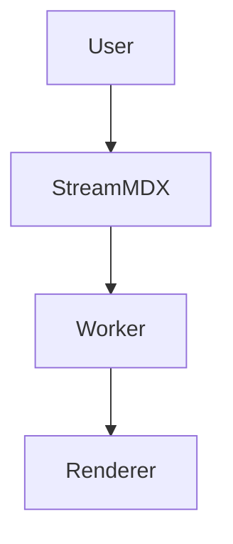

# Mermaid diagrams

Mermaid support is intentionally optional so core StreamMDX installs stay lean.

This showcase demonstrates the integration pattern: keep diagram rendering behind a dedicated component while the rest of the stream path stays unchanged.

## What this showcases

- Optional addon install (`@stream-mdx/mermaid`).
- Component registration for `mermaid` fenced code blocks.
- Safe fallback behavior (code view remains available).

## Install and wire

```bash
npm install @stream-mdx/mermaid
```

```tsx
import { StreamingMarkdown, type NodeViewProps } from "stream-mdx";
import { MermaidBlock } from "@stream-mdx/mermaid";

function MermaidPresentation({ block, children, metadata, actions }: NodeViewProps) {
  if (metadata.language?.toLowerCase() !== "mermaid") return children;
  const code = block?.payload.meta?.code;
  return (
    <MermaidBlock
      code={typeof code === "string" ? code : ""}
      renderCode={children}
      language={metadata.language ?? "mermaid"}
      blockId={metadata.id}
      controls={{ copy: true }}
      copy={actions.copy}
    />
  );
}

<StreamingMarkdown
  text={content}
  worker="/workers/markdown-worker.js"
  components={{ code: { wrapper: MermaidPresentation } }}
  features={{ mdx: true, html: true, tables: true, math: true }}
/>;
```

## Authoring contract

Use a normal fenced code block with `mermaid` language:

````md

````

## UX guidance

- Keep a **code/diagram toggle** so source remains inspectable.
- Default to code view if your app has strict CSP or heavy initial load pressure.
- Set `defaultView="diagram"` only where diagrams are primary content.

```tsx
import { StreamingMarkdown, type NodeViewProps } from "stream-mdx";
import { createMermaidBlock } from "@stream-mdx/mermaid";

const ConfiguredMermaidBlock = createMermaidBlock({
  config: { theme: "neutral" },
  defaultView: "diagram",
  errorComponent: ({ error, retry }) => (
    <div className="mermaid-error">
      <span>{error}</span>
      <button type="button" onClick={retry}>Retry</button>
    </div>
  ),
});

function ConfiguredMermaidPresentation({ block, children, metadata, actions }: NodeViewProps) {
  if (metadata.language?.toLowerCase() !== "mermaid") return children;
  const code = block?.payload.meta?.code;
  return (
    <ConfiguredMermaidBlock
      code={typeof code === "string" ? code : ""}
      renderCode={children}
      language={metadata.language ?? "mermaid"}
      blockId={metadata.id}
      controls={{ copy: true }}
      copy={actions.copy}
    />
  );
}

<StreamingMarkdown components={{ code: { wrapper: ConfiguredMermaidPresentation } }} />;
```

For custom themes, debouncing, or error retry UI, use `createMermaidBlock`:

```tsx
import { createMermaidBlock } from "@stream-mdx/mermaid";

const ConfiguredMermaidBlock = createMermaidBlock({
  config: { theme: "neutral" },
  defaultView: "diagram",
  errorComponent: ({ error, retry }) => (
    <div className="mermaid-error">
      <span>{error}</span>
      <button type="button" onClick={retry}>Retry</button>
    </div>
  ),
});
```

## Operational guidance

- Treat Mermaid like an optional feature flag in production.
- Validate diagram pages on mobile (SVG width and overflow wrappers).
- Include at least one regression snapshot for a representative diagram page.

## Failure mode checklist

- Diagram not rendering: verify addon installed and `components.code.wrapper` routes Mermaid fences to the Mermaid presentation.
- Layout overflow: wrap diagram container with horizontal overflow control.
- Hydration drift: avoid non-serializable props in surrounding MDX components.

## Next steps

- Full guide: [Mermaid diagrams guide](/docs/guides/mermaid-diagrams)
- Performance context: [Performance and backpressure](/docs/guides/performance-and-backpressure)
- Testing setup: [Testing and baselines](/docs/guides/testing-and-baselines)
